# Hero Forge

[](https://github.com/leosoldi/hero-forge/actions/workflows/ci.yml)

Plataforma de gestão de heróis: cadastre, liste, edite, desative e reative heróis com suas principais características e poderes. Inclui um extra que sugere heróis completos (dados, história e avatar) com IA generativa.


## Stack

| Camada         | Tecnologia                                                                                |
| -------------- | ----------------------------------------------------------------------------------------- |
| API            | Node.js 22, NestJS 12, TypeORM 1.x, Vitest                                                |
| Front-end      | React 19, Vite, TypeScript, Mantine, TanStack Query, React Hook Form + Zod, Vitest        |
| Banco de dados | MySQL 8.4 (LTS) em Docker                                                                 |
| IA generativa  | Cloudflare Workers AI (LLM Llama 3.3 70B + FLUX.1 schnell), com modo demonstração offline |

## Destaques

- **CRUD completo de heróis** seguindo REST: listagem paginada (10 por página, 5 por linha) e ordenada pelos mais recentes, busca por nome ou nome de guerra, filtro por status (todos, ativos ou inativos), exclusão lógica com reativação, e bloqueio de edição de heróis inativos.
- **Avatar por link ou upload**: a imagem enviada é validada pelos bytes do arquivo (JPEG, PNG ou WebP até 2 MB) e salva atrás de uma porta `FileStorage`, pronta para trocar o disco local por S3.
- **Sugerir herói com IA** (extra): no modal de criação, um **LLM** gera nome, nome de guerra, data de nascimento, universo, habilidade e uma história, e um **modelo de imagem** gera o avatar. O formulário é preenchido para revisão; nada é salvo sem o usuário confirmar.
  - Funciona sem chave nenhuma no **modo demonstração** (padrão), para quem avalia testar na hora.
  - Com a chave gratuita da Cloudflare, usa a IA real. O plano gratuito rende cerca de **100 sugestões por dia** (renova às 21h de Brasília); um ícone de informação ao lado do botão mostra esse limite.
  - Os provedores ficam atrás das portas `HeroIdeaGenerator` e `AvatarGenerator`: trocar de IA é criar um adapter, sem mexer em caso de uso nem no front.
- **Arquitetura em camadas** (domínio, casos de uso, infraestrutura, apresentação) com inversão de dependência, erros de domínio padronizados e documentação Swagger.
- **Testes** unitários e de integração na API (contra MySQL real) e testes de componente no front com MSW.

## Demonstração

### Sugerir herói com IA

A partir de uma ideia opcional, um LLM gera os dados e a história do herói, e um modelo de imagem cria o avatar. Tudo preenche o formulário para revisão antes de salvar.

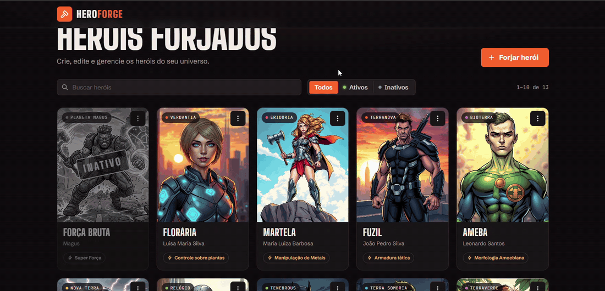

### Criação de herói com upload do avatar

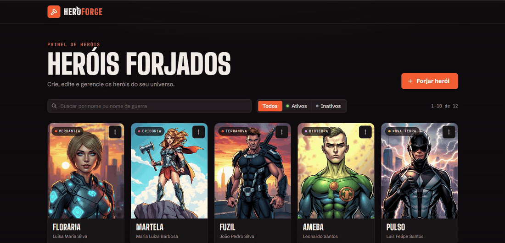

### Edição de herói

Todos os dados aparecem no modal, mas só os seis campos pedidos são editáveis; ID, status e datas ficam somente leitura.

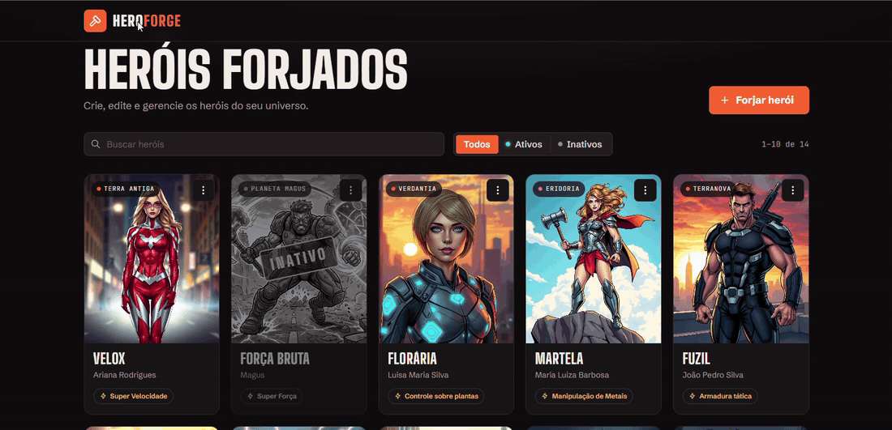

### Telas

| Listagem (10 por página, 5 por linha)               | Filtro por status                                      |
| --------------------------------------------------- | ------------------------------------------------------ |
| 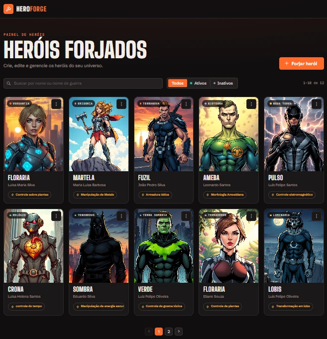 | 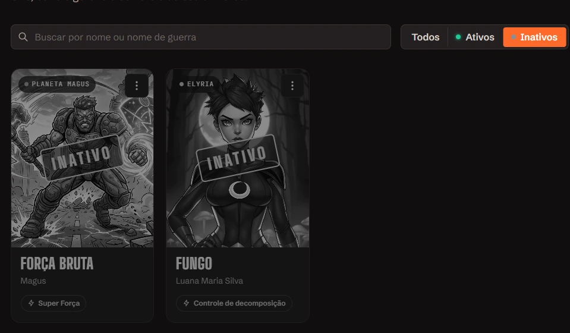 |
| **Criação com prévia ao vivo**                      | **Validação do formulário**                            |
| 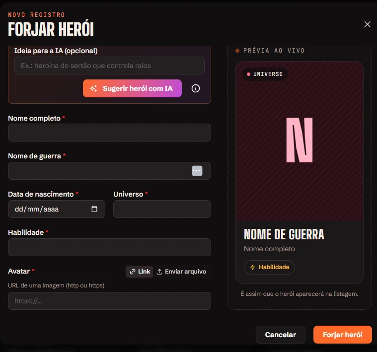        | 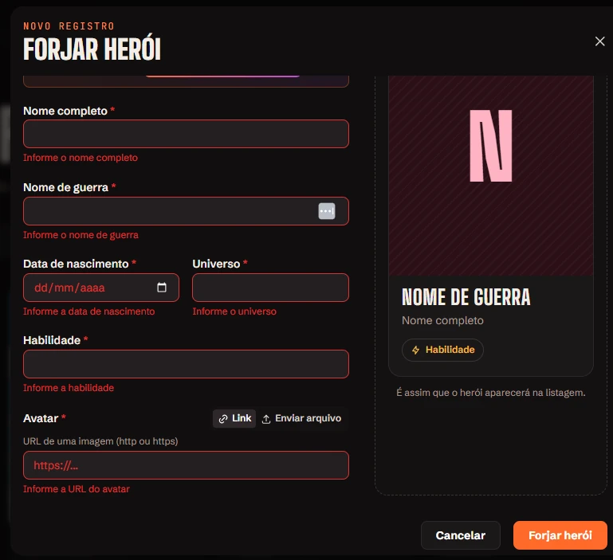                |
| **Detalhes do herói**                               | **Limite diário da IA**                                |
| 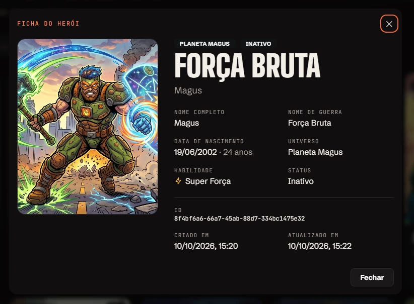               | 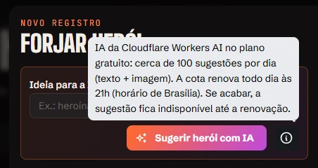             |

**Excluir e reativar:** a exclusão pede confirmação e deixa o herói inativo, em cinza. No herói inativo, "Ativar" substitui "Excluir" e a edição fica bloqueada.

<table>
  <tr>
    <td align="center"><br><sub>Ações</sub></td>
    <td align="center"><br><sub>Confirmação</sub></td>
    <td align="center">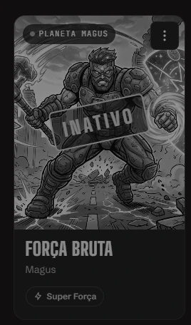<br><sub>Inativo</sub></td>
    <td align="center">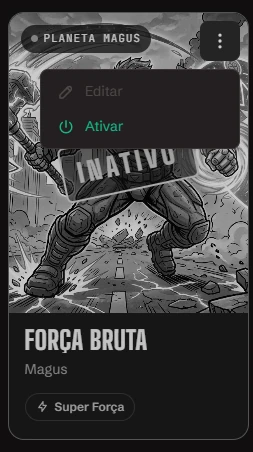<br><sub>Ativar</sub></td>
  </tr>
</table>

## Estrutura do repositório

```
hero-forge/
├── .github/workflows/  # CI: lint, typecheck, testes e subida da stack em Docker
├── apps/
│   ├── api/            # API REST (NestJS) + Dockerfile
│   └── web/            # Front-end (React + Vite) + Dockerfile e nginx.conf
├── docker/
│   └── mysql/init/     # Scripts executados na primeira subida do MySQL
├── docs/media/         # Capturas de tela e GIFs do README
├── docker-compose.yml  # MySQL, API e front
└── package.json        # npm workspaces
```

## Pré-requisitos

- [Docker Desktop](https://www.docker.com/products/docker-desktop/) (no Windows, com WSL 2)
- [Node.js 22+](https://nodejs.org/), só para o modo de desenvolvimento e para rodar os testes
- Git

## Como rodar

Há dois jeitos de rodar o projeto. Use **um ou outro**, porque os dois usam a porta `3333`.

### Opção 1: tudo em Docker (mais rápido para avaliar)

```bash
cp .env.example .env
docker compose up -d --build
```

O primeiro build leva alguns minutos. Quando terminar:

| Serviço   | Endereço                   |
| --------- | -------------------------- |
| Aplicação | http://localhost:8080      |
| API       | http://localhost:3333      |
| Swagger   | http://localhost:3333/docs |
| MySQL     | `localhost:3306`           |

A ordem de subida é controlada por _healthchecks_: a API só sobe quando o MySQL está pronto (e roda as migrations sozinha), e o front só sobe quando a API responde em `/health`. Para acompanhar: `docker compose ps` e `docker compose logs -f api web`.

Como é montado:

- **API**: build em múltiplos estágios (compila com as dependências de desenvolvimento, e a imagem final leva só o `dist` e as dependências de produção). Roda com o usuário `node`, sem privilégios de root. As imagens enviadas ficam no volume `uploads_data`.
- **Front**: o Vite gera os arquivos estáticos e o **nginx** os serve. O próprio nginx repassa `/api` e `/uploads` para a API, o mesmo contrato do proxy do Vite em desenvolvimento, então o front não precisa saber o endereço da API.
- **IA**: sem configuração, roda em modo demonstração. Se o arquivo `apps/api/.env` existir, as chaves da Cloudflare dele são reaproveitadas (veja "IA generativa" abaixo).

As portas podem ser trocadas no `.env` (`WEB_PORT`, `API_PORT` e `MYSQL_PORT`).

| Script                | Descrição                                    |
| --------------------- | -------------------------------------------- |
| `npm run docker:up`   | Faz o build e sobe MySQL, API e front        |
| `npm run docker:ps`   | Mostra o estado e a saúde de cada container  |
| `npm run docker:logs` | Acompanha os logs da API e do front          |
| `npm run docker:down` | Para e remove os containers (os dados ficam) |

### Opção 2: desenvolvimento (com _hot reload_)

#### 1. Variáveis de ambiente

```bash
cp .env.example .env
```

#### 2. Banco de dados

```bash
npm run db:up
```

Sobe só o MySQL 8.4 na porta `3306` (configurável via `MYSQL_PORT`) com dois bancos:

- `hero_forge`: usado pela aplicação
- `hero_forge_test`: usado pelos testes de integração

| Script             | Descrição                                 |
| ------------------ | ----------------------------------------- |
| `npm run db:up`    | Sobe o container do MySQL                 |
| `npm run db:down`  | Para o container do MySQL                 |
| `npm run db:logs`  | Acompanha os logs do MySQL                |
| `npm run db:reset` | Apaga os volumes e recria o banco do zero |

#### 3. API

```bash
npm install
cp apps/api/.env.example apps/api/.env
npm run api:dev
```

A API sobe em `http://localhost:3333` e a documentação interativa (Swagger) fica em `http://localhost:3333/docs`.

Mais detalhes (variáveis de ambiente, scripts e endpoints) em [`apps/api/README.md`](apps/api/README.md).

#### 4. Front-end

Em outro terminal, com a API rodando:

```bash
npm run web:dev
```

A aplicação abre em `http://localhost:5173`. Mais detalhes em [`apps/web/README.md`](apps/web/README.md).

### IA generativa (opcional, vale para as duas opções)

Por padrão a API roda com `AI_PROVIDER=demo`: o botão "Sugerir herói com IA" funciona offline, com sugestões e avatares gerados localmente.

Para usar a IA real, gratuita, crie uma conta na [Cloudflare](https://dash.cloudflare.com), pegue o **Account ID** e um **API Token** do Workers AI e preencha no `apps/api/.env`:

```env
AI_PROVIDER=cloudflare
CLOUDFLARE_ACCOUNT_ID=seu-account-id
CLOUDFLARE_API_TOKEN=seu-token
```

Reinicie a API (`npm run api:dev` ou `docker compose up -d api`). O passo a passo e os detalhes do endpoint estão em [`apps/api/README.md`](apps/api/README.md#sugestão-de-herói-com-ia-generativa).

## Testes

Com o MySQL rodando (`npm run db:up`):

```bash
npm run api:test        # unitários da API
npm run api:test:e2e    # integração da API contra o MySQL (banco hero_forge_test)
npm run web:test        # componentes e fluxos do front
npm run api:test:cov    # unitários da API com cobertura
npm run web:test:cov    # testes do front com cobertura
```

| Suíte                     | Testes | Cobertura (linhas / desvios)                  |
| ------------------------- | ------ | --------------------------------------------- |
| API: unitários            | 119    | 96% / 89%                                     |
| API: integração (MySQL)   | 43     | rotas, repositório e uploads de ponta a ponta |
| Front: componentes/fluxos | 68     | 96% / 92%                                     |

- **Unitários da API** cobrem domínio, casos de uso, mappers, presenters, DTOs e adapters da IA, usando um repositório em memória no lugar do banco.
- **Integração da API** sobe a aplicação Nest de verdade e testa as rotas com Supertest contra um MySQL real, incluindo regressões de fuso horário (datas que "voltavam um dia" fora do UTC).
- **Front** testa componentes e fluxos completos (listar, buscar, filtrar, criar, editar, excluir, reativar) com Testing Library e a API simulada pelo MSW.

O **CI** (GitHub Actions) roda a cada push: lint, typecheck, todos os testes (com um MySQL 8.4 de verdade) e, por fim, sobe a stack inteira com `docker compose` e faz um teste de fumaça nos endpoints.

## Decisões técnicas

| Escolha                       | Por quê                                                                                                                                                                                         |
| ----------------------------- | ----------------------------------------------------------------------------------------------------------------------------------------------------------------------------------------------- |
| **NestJS**                    | É o framework Node que domino. A injeção de dependência nativa facilita aplicar SOLID e trocar implementações nos testes, e já traz validação (`ValidationPipe`), filtros de exceção e Swagger. |
| **TypeORM**                   | Integração oficial com o Nest, padrão Data Mapper + Repository e migrations versionadas: o schema do banco fica no Git e é reproduzível.                                                        |
| **MySQL 8.4 (LTS)**           | Atende ao "8.0+" do enunciado na versão com suporte de longo prazo (a 8.0 saiu de suporte em abril de 2026).                                                                                    |
| **React + Vite**              | Build rápido e sem configuração extra; o proxy do Vite deixa front e API na mesma origem em desenvolvimento, como o nginx faz no Docker.                                                        |
| **Mantine**                   | Biblioteca completa e acessível (modais, menus, notificações), fácil de tematizar para uma identidade própria.                                                                                  |
| **TanStack Query**            | Resolve três requisitos diretamente: loading de toda interação assíncrona, cache e "atualizar a lista" após cada ação (invalidação de queries).                                                 |
| **React Hook Form + Zod**     | Formulários com validação tipada no front, espelhando as regras da API.                                                                                                                         |
| **Vitest em todo o monorepo** | Um só test runner para API e front, rápido e com suporte nativo a TypeScript e ESM.                                                                                                             |
| **Cloudflare Workers AI**     | Plano gratuito que gera texto **e** imagem com a mesma conta. Fica atrás de portas, então trocar de provedor é criar um adapter.                                                                |

### Arquitetura da API

A API é modular por funcionalidade, com camadas inspiradas em Clean Architecture / Ports & Adapters, de forma pragmática:

```
modules/heroes/
├── domain/          # Entidade Hero, regras de negócio, porta do repositório e erros de domínio (sem Nest, sem TypeORM)
├── application/     # Casos de uso: um por ação (criar, listar, detalhar, editar, excluir, ativar)
├── infrastructure/  # Adapter TypeORM, entidade do banco e mapper banco <-> domínio
└── presentation/    # Controller REST, DTOs com validação e presenter (snake_case e datas no formato pedido)
```

Os casos de uso dependem só de abstrações (`HeroRepository`, `FileStorage`, `HeroIdeaGenerator`, `AvatarGenerator`), e o Nest injeta as implementações. Por isso o mesmo caso de uso roda com o MySQL em produção e com um repositório em memória nos testes. Padrões usados: Repository, Adapter, Strategy (provedores de IA), Data Mapper, DTO + Presenter, Use Case e Exception Filter.

Erros de domínio viram respostas HTTP padronizadas em um único filtro global:

```json
{
  "status_code": 409,
  "code": "HERO_INACTIVE",
  "message": "Hero 816b2cf2-... is inactive and cannot be updated"
}
```

| Situação                                                                | Status                                     |
| ----------------------------------------------------------------------- | ------------------------------------------ |
| Campos inválidos na requisição                                          | `400` (com a lista de campos em `details`) |
| Herói não encontrado                                                    | `404`                                      |
| Editar herói inativo, ativar herói já ativo ou excluir herói já inativo | `409`                                      |
| Regra de domínio violada                                                | `422`                                      |
| IA indisponível ou cota esgotada                                        | `503`                                      |

O front traduz cada `code` para uma mensagem em português e diferencia "API fora do ar" de "API respondeu com erro".

### Regras de negócio e interpretações

- **"Excluir" é exclusão lógica** (`is_active = false`), não física. O próprio enunciado pede isso indiretamente: um herói desativado troca "Excluir" por "Ativar", e só dá para reativar o que continua no banco.
- **Herói inativo não pode ser editado**, e a regra é garantida na API (`409`), não só escondida na interface.
- **Somente os seis campos editáveis são aceitos.** Enviar `id`, `is_active`, `created_at` ou `updated_at` faz a requisição ser rejeitada com `400`.
- **Listagem** no formato `{ data, meta }`. Cada item segue exatamente o modelo de herói do enunciado, e `meta` traz a paginação. A ordem é `created_at` decrescente, com o `id` como desempate para a paginação ser estável.
- **Datas** são gravadas em UTC e devolvidas como `YYYY-MM-DD HH:mm:ss`. `date_of_birth` é validada de forma estrita (`2026-02-31` é rejeitado em vez de virar 3 de março).
- **Busca** por nome ou nome de guerra, tratando `%` e `_` como texto (sem curingas acidentais).

## Propostas de melhoria

- **Armazenamento de imagens em nuvem.** Trocar o `LocalFileStorage` por um adapter S3 ou MinIO. A porta `FileStorage` já existe, então é um adapter novo e uma linha no módulo, permitindo escalar a API horizontalmente.
- **Limite de requisições** (`@nestjs/throttler`), principalmente na sugestão por IA, para proteger a cota diária se a aplicação for publicada.
- **Limpeza de uploads órfãos.** Imagens enviadas ou geradas pela IA que nunca viraram herói podem ser removidas por uma rotina agendada.
- **Paginação por cursor** (`created_at` + `id`) se a base crescer muito, evitando o custo do `OFFSET` em páginas altas, e um índice full-text para a busca.
- **Cache** da listagem (Redis) com invalidação nas escritas, se a leitura passar a dominar o tráfego.
- **Observabilidade:** logs estruturados com ID de requisição, métricas e rastreamento (OpenTelemetry).
- **Autenticação e auditoria** (quem criou, editou ou excluiu), caso a plataforma passe a ter usuários.
- **Testes end-to-end no navegador** (Playwright) cobrindo os fluxos principais contra a stack em Docker.
